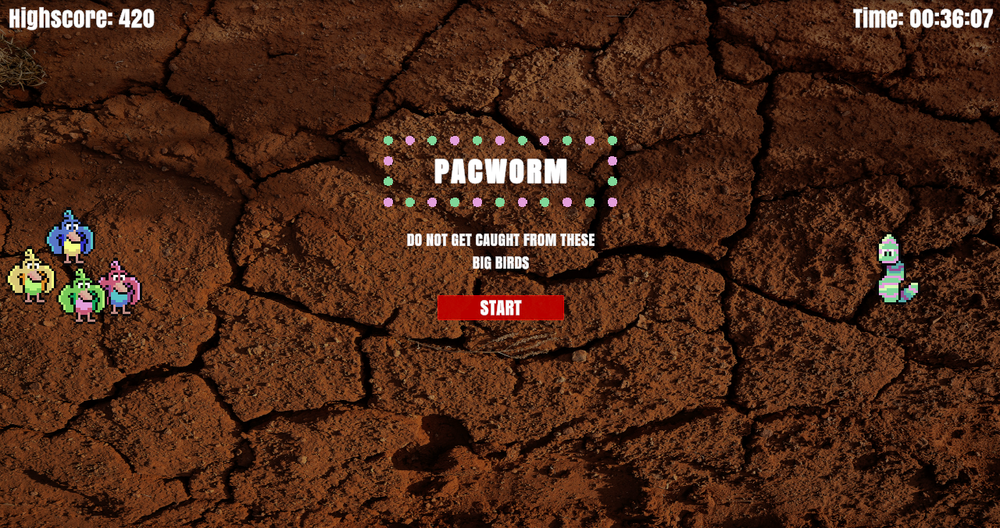
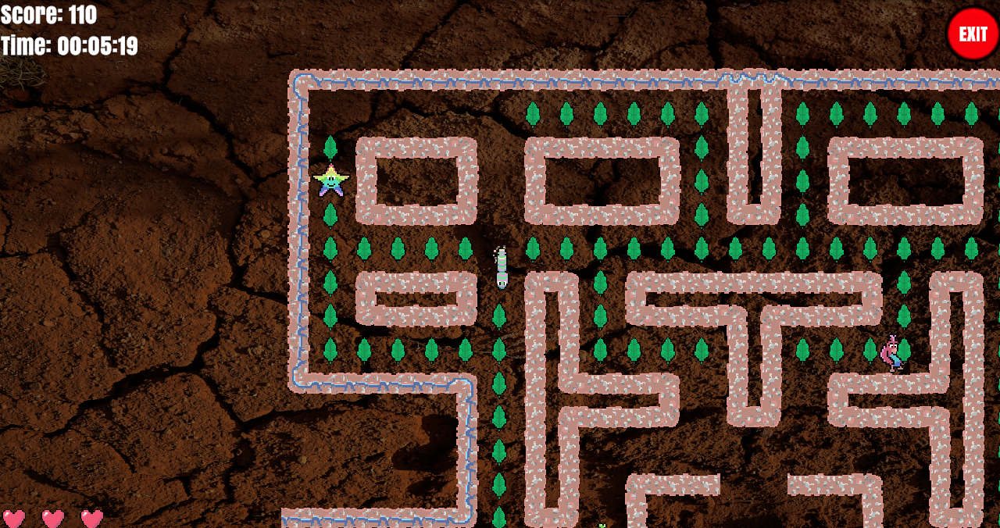
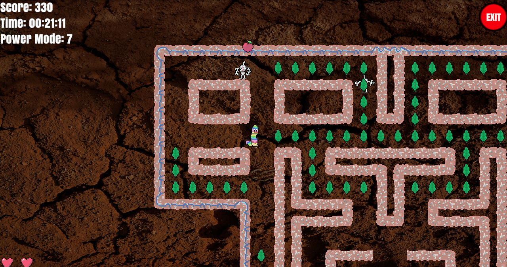

# PACWORM 🪱🍎

PACWORM is a recreation of the famous Atari-era game pac-man, but with own designs and new features. All graphics, animations and sounds are unique and hand crafted*.
Enjoy playing a fun game of pure nostalgia.

[You can play here! 🪱](https://play.unity.com/en/games/63efdd00-1acc-4dc9-a110-08de12107a25/pacworm)

\* Except for the background image

## Controls & Gameplay 🎮 

Control PACWORM 🪱 with the W A S D keys 🔑 to collect as many delicious leafs as possible while hiding from the 4 birds.🐦
And maybe you can also catch an even more delicious apple!🍎
You can take the birds out of the game for a few seconds when in POWER MODE 🌈🚀.

HAVE FUN PLAYING!

## Walkthrough 🛡️

The game starts in a simple intro screen. Click on _Start_ to play!

During the game you can always see your current score and the time played.🧭

Try beating your or your friends highscore!🔥
However, if you want to quit early you will always have the option to click on the big _Exit_ button in the up-right corner.

Scare away the birds in Power Mode! (I think they are afraid of rainbows! 🌈)

## Contribution
This project was developed as my final submission for the _Game Development_
course at University of Technology Sydney.

## References
Background image from <a href="https://unsplash.com/de/@claybanks?utm_content=creditCopyText&utm_medium=referral&utm_source=unsplash">Clay Banks</a> on <a href="https://unsplash.com/de/fotos/braune-betonziegelmauer-tagsuber-EdscD_R28bM?utm_content=creditCopyText&utm_medium=referral&utm_source=unsplash">Unsplash</a>
      
